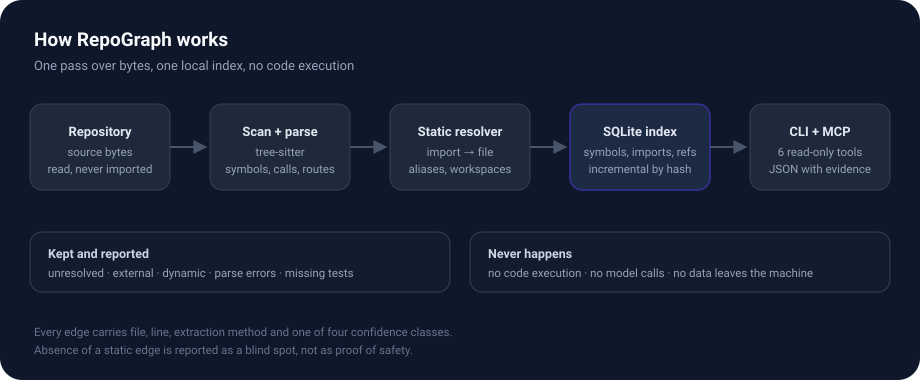

<h1 align="center">
  <picture>
    <source media="(prefers-color-scheme: dark)" srcset="docs/assets/hero-dark.svg">
    
  </picture>
</h1>

<p align="center">
  <a href="https://github.com/INDEX0-RESEARCH-LABS/repograph/actions/workflows/ci.yml"></a>
  <a href="https://www.python.org/downloads/"></a>
  <a href="LICENSE"></a>
  <a href="STATUS.md"></a>
</p>

<p align="center">
  <b>See what a code change touches — before you ship it.</b><br>
  Runs on your machine. No account, no API key, no code execution.
</p>

**RepoGraph is a local-first code graph and change impact analysis tool for AI coding agents.** It reads your repository, records what imports what, and answers one question:

> **"If I change this file, what else might break?"**

You get a list of the files, tests and routes that depend on it. Each item shows where the evidence comes from (file and line) and how sure the tool is. It also tells you what it **could not see**.

It works on Python, TypeScript, JavaScript, JSX and TSX.

```bash
repograph index .
repograph impact src/payments/refund.py
```

Real output from the project's test fixture, unedited:

```
changed files (1): src/shop/services/subscription.py
changed symbols: 1
  function  cancel  src/shop/services/subscription.py:6

direct dependents (4):
  [confirmed] src/shop/__init__.py  (imports-changed-file at line 1)
  [confirmed] src/shop/api/routes.py  (imports-changed-file at line 3)
  [confirmed] src/shop/services/billing.py  (imports-changed-file at line 1)
  [confirmed] tests/test_subscription.py  (imports-changed-file at line 1)
transitive dependents: 1
  [confirmed] depth 2 src/shop/app.py

related tests (1):
  [inferred] tests/test_subscription.py  (test-imports-changed-file, test-name-matches-changed-file, test-name-matches-dependent)

affected routes:
  POST /subscriptions/{subscription_id}/cancel  src/shop/api/routes.py:8

documentation mentions:
  docs/adr/0001-subscription-cancellation.md:1
  docs/adr/0001-subscription-cancellation.md:3
  docs/adr/0001-subscription-cancellation.md:5

blind spots:
  - repo-dynamic-imports (2): Dynamic imports exist in the repository; their runtime targets may include the changed files.
  - repo-parse-errors (1): Files with parse errors contribute no symbols or edges anywhere in the index.

note: absence of static evidence is not evidence of safety.
```

> **Status: 0.1.0 alpha.** Static analysis only. See [STATUS.md](STATUS.md) for what is tested and what is not.

## Contents

- [Install](#install)
- [Use it in 2 minutes](#use-it-in-2-minutes)
- [Use it with your AI coding agent](#use-it-with-your-ai-coding-agent)
- [Commands](#commands)
- [What the labels mean](#what-the-labels-mean)
- [How accurate is it?](#how-accurate-is-it)
- [How fast is it?](#how-fast-is-it)
- [How it works](#how-it-works)
- [What it cannot do](#what-it-cannot-do)
- [Common problems](#common-problems)
- [For contributors](#for-contributors)
- [License](#license)

## Install

You need **Python 3.10 or newer**. Nothing else. No database server, no Docker, no cloud.

RepoGraph is not on PyPI yet, so install it from the code:

```bash
git clone https://github.com/INDEX0-RESEARCH-LABS/repograph.git
cd repograph
python -m venv .venv
.venv/bin/pip install -e .
.venv/bin/repograph version
```

If you use `pipx`, this also works: `pipx install --editable .`

## Use it in 2 minutes

Run these inside **your** project, not inside RepoGraph:

```bash
cd /path/to/your/project
repograph init .              # create the local index folder
repograph index .             # read the code and build the map
repograph status .            # check what was found
repograph impact src/app.py   # ask what depends on this file
```

Change the path in the last line to a real file in your project. That is the whole loop. After you edit code, run `repograph index .` again so the map is current.

If `repograph` is not found, activate the environment first (`source .venv/bin/activate`) or call `.venv/bin/repograph`.

New to the terminal? The four commands above are safe. They only read files. RepoGraph never runs your code.

## Use it with your AI coding agent

AI assistants forget what they have not read. Give yours a map instead of a wall of grep results.

RepoGraph speaks **MCP** (Model Context Protocol), the standard way AI tools call outside helpers. Index the project first, then start the server:

```bash
repograph serve --root /path/to/your/project
```

Add it to your client config. Most MCP clients accept this JSON shape (Claude Code and Cursor, for example):

```json
{
  "mcpServers": {
    "repograph": {
      "command": "repograph",
      "args": ["serve", "--root", "/absolute/path/to/your/project"]
    }
  }
}
```

Then ask your agent to use it, in plain words:

> Before you change a file, call `analyze_change_impact` and use the result to check what else needs updating. If it reports a blind spot, say so.

The server exposes six read-only tools:

| Tool | What it returns |
| --- | --- |
| `search_symbols` | Names that match your search, with file and line. |
| `find_references` | Where a symbol is defined and where it is used. |
| `get_dependency_graph` | What a file imports and what imports it. |
| `analyze_change_impact` | Dependents, tests, routes, models and blind spots for a change. |
| `find_related_tests` | Candidate tests for a change. Heuristic — always run the suite. |
| `get_architecture_summary` | Languages, layers, hubs, entry points, routes and models. |

`python -m repograph.mcp_server` also works and reads `REPOGRAPH_ROOT`.

> **Security:** HTTP mode (`serve --http`) has **no authentication**. It binds to `127.0.0.1` by default. Do not expose it to an untrusted network.

## Commands

Every read command accepts `--json`, so scripts and agents can parse the output.

| Command | What it does |
| --- | --- |
| `repograph init [path]` | Create `.repograph/` with a config file. |
| `repograph index [path]` | Build or update the map. `--force` reparses everything; `--reset` starts over. |
| `repograph status [path]` | Show counts, parse errors and whether an update is needed. |
| `repograph search <text>` | Find symbols and source text. Add `--kind` to filter. |
| `repograph refs <name>` | Show a definition and the places that use it. |
| `repograph graph [path]` | Show imports in, out or both. `--depth 1-5`, `--format dot`, `--cycles`. |
| `repograph arch` | Summarize layers, hubs, entry points, routes and models. |
| `repograph impact <paths>` | Dependents, tests, routes and blind spots. `--symbol`, `--diff`, `--depth`. |
| `repograph serve` | Start the MCP server. `--http`, `--host`, `--port`. |
| `repograph version` | Print the version. |

Two habits worth keeping:

- **After editing**, re-index before analyzing: `repograph index . && repograph impact --diff`.
- **Read the blind spots.** "No dependents found" is not "safe to ship".

## What the labels mean

Each link carries one label. They tell you how much to trust it.

| Label | Plain meaning |
| --- | --- |
| `confirmed` | The code says it directly: a real import, or a call in the same file. |
| `inferred` | Worked out from project setup: a TypeScript alias or workspace package. |
| `heuristic` | A guess from patterns: route decorators, model base classes, test names. |
| `unresolved` | Seen in the code, but the target could not be found. Kept and reported. |

Cycles are shown as cycles. They are not treated as errors.

## How accurate is it?

Measured in October 2026 with a pre-registered protocol and two independent AI labelers, on three repositories never used to build the tool.

| Repository | Correct links (precision) | Links found (recall) |
| --- | ---: | ---: |
| [httpx](https://github.com/encode/httpx) (Python) | 100% (30/30) | 100% (30/30) |
| [zustand](https://github.com/pmndrs/zustand) (TypeScript) | 96.7% (58/60) | 100% (58/58) |
| [mocha](https://github.com/mochajs/mocha) (JavaScript) | 100% (30/30) | 78.9% (30/38) |
| **Overall** | **98.3%** (118/120) | **93.7%** (118/126) |

- 95% intervals: precision 94.1%–99.5%, recall 88.0%–96.8%.
- Both mistakes were one bug (a config alias leaking into example apps). It is fixed and rechecked; the measured figure stays 118/120.
- All eight missed links were JSON files in mocha. JSON is not part of the code map, which is why mocha's recall is shown on its own.
- Recall is an estimate, not a census. JSON/config imports, some Node aliases and non-code assets (`.css`, images, `.vue`) are not mapped.

Full method, raw samples and threats to validity: [research/EDGE_ACCURACY_RESULTS.md](research/EDGE_ACCURACY_RESULTS.md).

## How fast is it?

One machine, one run per project (Linux x86_64, Python 3.14.8, October 2026). Times are for the index step, not for your whole CI pipeline.

| Repository | Files | Symbols | First index | Update (no changes) | Index size | Impact query |
| --- | ---: | ---: | ---: | ---: | ---: | ---: |
| [express](https://github.com/expressjs/express) | 142 | 63 | 0.28 s | 0.08 s | 176 KiB | 2.1 ms |
| [click](https://github.com/pallets/click) | 91 | 2,077 | 0.57 s | 0.06 s | 960 KiB | 18.4 ms |
| [requests](https://github.com/psf/requests) | 37 | 807 | 0.26 s | 0.04 s | 508 KiB | 8.2 ms |
| [vue-core](https://github.com/vuejs/core) | 528 | 2,273 | 1.79 s | 0.24 s | 1.5 MiB | 22.4 ms |
| [fastapi](https://github.com/fastapi/fastapi) | 1,223 | 7,125 | 5.26 s | 1.10 s | 4.0 MiB | 82.1 ms |

Express is a known weak spot: its CommonJS export style produces few symbols from many files. The report says so instead of hiding it.

## How it works

<p align="center">
  
</p>

1. **Scan** — walk the folder. Skip binaries, symlinks, huge files, secret-looking filenames and anything you exclude.
2. **Parse** — tree-sitter (a parser library) extracts symbols, imports, calls, routes and models. It reads bytes and never runs code.
3. **Resolve** — match each import to a real file: Python paths, TypeScript aliases, workspace packages, `require`, literal dynamic imports.
4. **Store** — write a small SQLite file inside `.repograph/`. Updates are incremental.
5. **Query** — walk the graph, find reverse imports and cycles, and build the impact report.

Design and schema: [docs/ARCHITECTURE.md](docs/ARCHITECTURE.md).

## What it cannot do

- **It is static.** It reads code, it does not run it. Reflection, computed imports and runtime wiring can be invisible.
- **Two language families.** Python and JavaScript/TypeScript. Other languages are ignored.
- **No type checking or data-flow.** It follows imports and names, not values.
- **Test suggestions are heuristic.** A measured run on Flask found **24% of the failing test files** (60% when indirect dependents are counted). Always run the full suite.
- **Routes and models are partial.** Common frameworks are recognized, not all of them.
- **An empty result is not proof.** If nothing depends on a file, RepoGraph says "no dependents found", not "safe". Re-index, then verify.

It is not a compiler, a type checker, a semantic search engine, or a replacement for tests.

## Common problems

| Problem | Fix |
| --- | --- |
| `impact --diff` finds nothing | The edit is not indexed. Run `repograph index .` first. |
| Fewer symbols than expected | The code may use a pattern the parser does not cover. Check `repograph status` and `repograph arch` for parse errors. |
| "A dependency is missing" | It may be dynamic, unresolved, or in another language. Check the blind spots block. |
| MCP client cannot connect | Use an absolute `--root` path, and make sure `repograph` is on the client's `PATH`. |

## For contributors

```bash
.venv/bin/pip install -e '.[dev]'
.venv/bin/python -m pytest
.venv/bin/python -m pytest --cov=repograph --cov-report=term-missing
```

62 tests, 70% direct coverage. CI runs Python 3.10, 3.12 and 3.13, then smoke-tests `repograph arch --root .`. The CLI and MCP server are tested through subprocesses, so coverage does not attribute those runs to their modules.

[CONTRIBUTING.md](CONTRIBUTING.md) covers style and review. Report security issues privately as described in [SECURITY.md](SECURITY.md).

## License

Apache-2.0. See [LICENSE](LICENSE).
