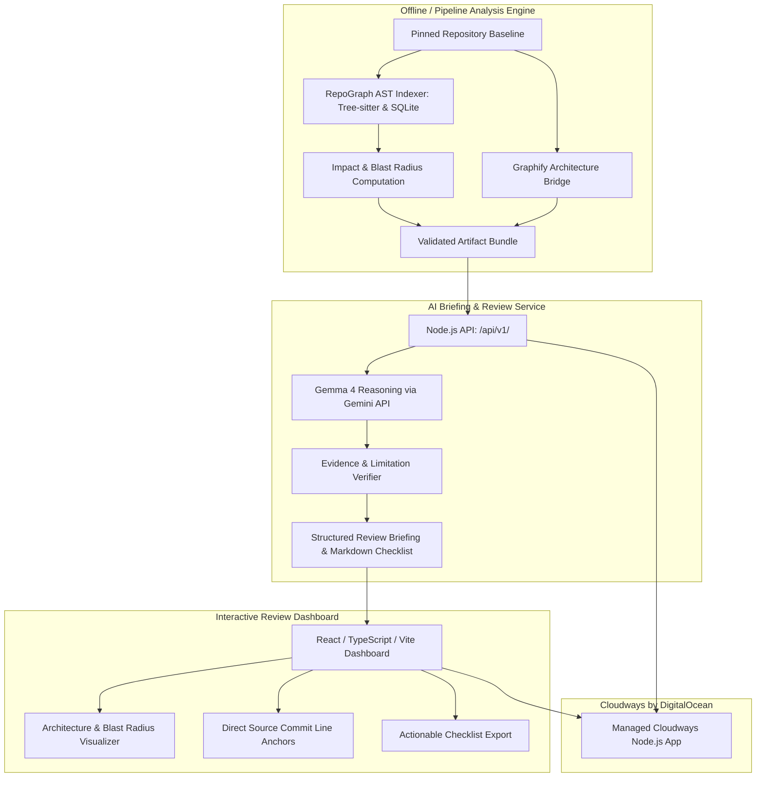

# RepoGraph Review Desk 🧠🕸️

> **Graph-Aware Code Review Desk & AI Impact Briefing Engine**  
> An evidence-backed companion application combining deterministic AST dependency analysis, architectural topology via Graphify, and Gemma 4 reasoning (via Google Gemini API) with a high-performance React dashboard deployable to Cloudways by DigitalOcean.

---

## 🌟 Key Features

- **Deterministic AST Impact Analysis**: Powered by RepoGraph's incremental Tree-sitter and SQLite engine, tracing exact symbol definitions, imports, calls, and blast radii.
- **Architecture Context via Graphify**: Bridges fine-grained code references into Graphify architectural relationship graphs.
- **Evidence-Grounded Gemma 4 Reasoning**: Evaluates pull requests and file-impact scenarios using Gemma 4 (`gemma-4-26b-a4b-it` / `gemma-4-31b-it`), anchoring all findings to verified source lines and strictly preserving limitations.
- **Interactive Review Dashboard**: High-performance React 18 / TypeScript / Vite interface with 100% automated accessibility compliance (Axe + Playwright), dark/light modes, citation navigation, and Markdown checklist export.
- **Production-Ready Seams**: Clean native HTTP launcher serving both the SPA frontend and `/api/v1/` endpoints on a unified origin.

---

## 🏗️ Architecture



---

## 🚀 Quickstart

### Prerequisites
- Node.js `20.18+`, `22.12+`, or `24`
- Python 3.10+ (for running the offline analysis dataset builder)

### 1. Build and Start

```bash
# Install frontend dependencies and build production assets
npm run build

# Start the unified Review Desk server
npm start
```

Open [http://localhost:3000](http://localhost:3000) in your browser.

### 2. Run Verification & Preflight

```bash
# Run starter and service test suites
npm test

# Run offline readiness preflight check
npm run check:ready

# Run production environment validation
npm run check:production
```

---

## 📡 API Reference

| Endpoint | Method | Description |
|---|---|---|
| `/api/v1/health` | `GET` | Health check, AI mode (`live` / `fixture`), and artifact provenance. |
| `/api/v1/catalog` | `GET` | Repository metadata, tools versions, and available scenario catalog. |
| `/api/v1/cases/:id` | `GET` | Detailed impact case definition, affected files, tests, and architecture. |
| `/api/v1/briefings` | `POST` | Generates evidence-grounded review briefing with verified citations. |

---

## 🔐 Environment Configuration

Copy `.env.example` to `.env` or configure process environment variables:

```bash
PORT=3000
NODE_ENV=production
AI_MODE=live
GEMMA_MODEL=gemma-4-26b-a4b-it
GEMMA_API_KEY=your_gemini_api_key_here
ARTIFACT_BUNDLE=data/production/artifact-bundle.json
API_HANDLER_MODULE=service/api-handler.mjs
WEB_DIST=web/dist
```

---

## 📚 Documentation

- [Judges & Evaluation Guide](docs/JUDGES_GUIDE.md) 🏆
- [System Architecture](docs/ARCHITECTURE.md)
- [Analysis Engine Guide](docs/ANALYSIS_ENGINE.md)
- [Briefing Service & API](docs/API_SERVICE.md)
- [Deployment Guide (Cloudways)](docs/DEPLOYMENT_GUIDE.md)
- [Interface Contracts](CONTRACT.md)

---

## 📄 License

This project is licensed under the [MIT License](LICENSE).
