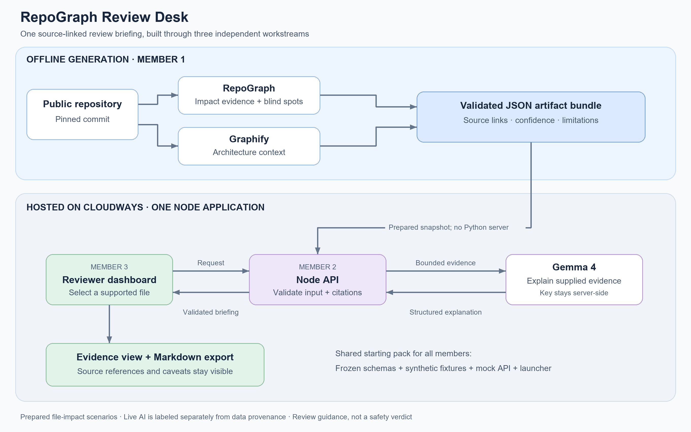
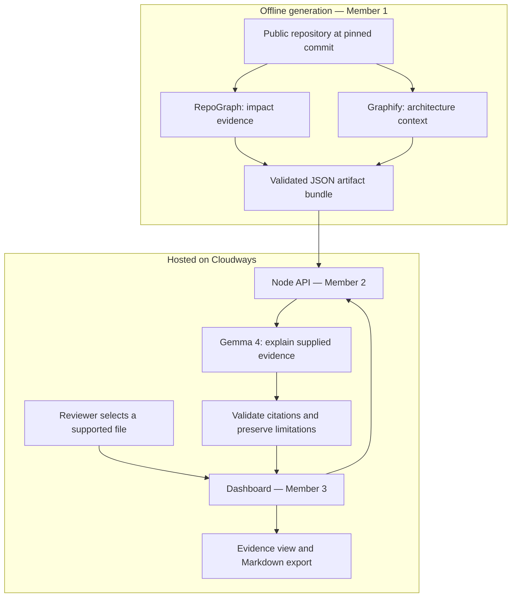

# RepoGraph Review Desk

## Member 3 implementation status — 31 October 2026

The React/TypeScript/Vite dashboard is implemented under `web/` and verified independently against the supplied mock API. It includes scenario browsing, impact/Graphify context, source-linked citations, limitations, optional intention, briefing generation, and exact Markdown download. Analysis provenance and inference mode are always distinguished. The current data is synthetic and inference is canned; production analysis, real API/live Gemma, and public Cloudways deployment remain integration checkpoints.

From this directory with Node **22.12+ or 24**:

```powershell
npm run build
npm start
```

Open `http://localhost:3000`. Build installs locked frontend dependencies into `web/` and creates `web/dist`; start runs the unchanged launcher for static files and `/api/` on one origin. No API key is needed for mock development. For hot reload, run `npm run dev:web` in a second terminal while the launcher is running.

Verification (build first):

```powershell
npm --prefix web exec -- playwright install chromium
npm test
node deployment/smoke.mjs http://127.0.0.1:3000 --record
```

The browser suite uses its own fixture launcher on port 4310 and includes automated accessibility scans. `npm run check:ready` performs an offline mock preflight; `npm run check:production` reports real handoff/environment blockers without model calls or secret values. `npm run package:handoff` packages Member 3's owned-file overlay with SHA-256 inventories; see [handoff and repository setup](deployment/HANDOFF.md).

See [progress](deployment/PROGRESS.md), [acceptance](deployment/ACCEPTANCE.md), [Cloudways/manual setup](deployment/RUNBOOK.md), [integration checklist](deployment/INTEGRATION.md), and [submission/demo materials](deployment/SUBMISSION.md). The [public Cloudways fixture demo](https://nodejs-1684692-6760452.cloudwaysnodeapps.com/) passes API smoke and 9 independent browser checks after the PM2 startup adapter. This verifies hosting and the canned fixture journey; generated analysis and live Gemma remain pending. The [companion repository](https://github.com/D33PAKsoni/repograph-review-desk) is separate from the original RepoGraph analysis fork.

New companion code is available under the [MIT license](LICENSE); see [attribution and baseline](ATTRIBUTION.md). The handoff below describes the original plan and ownership boundaries; Member 3's dashboard/build have now been implemented. All frozen starter interfaces remain unchanged.

## Original three-member technical handoff

**Core objective:** give a reviewer an evidence-backed briefing about what a file change might affect. Build a new companion application around RepoGraph. The app combines RepoGraph impact evidence, Graphify architecture context, and a live Gemma explanation, then presents the result on Cloudways.

By the end of Phase 1, a judge should be able to open the public URL, choose a supported changed-file scenario, inspect source evidence and limitations, request a Gemma briefing, and download its Markdown checklist. Every source link identifies the repository commit used for analysis. The product gives review guidance; it does not certify safety or replace the full test suite.



The upper half runs offline during development. The lower half is the public application. Prepared snapshots make the MVP reproducible; **label them as prepared file-impact scenarios**, not live PR or patch analysis.



## 1. What the team is building

The MVP supports **one public reference repository, one pinned commit, and one complete main scenario**. The initial input is RepoGraph itself at the baseline commit below, with `src/repograph/impact.py` as the changed-file scenario. Target three scenarios only after the main path works. A scenario is a hypothetical change to an identified file; different behavioral patches to that file are not analyzed independently in Phase 1.

| Objective | Required behavior | Evidence for judges |
|---|---|---|
| Make change impact understandable | Show dependents, suggested tests, source evidence, and unknowns. | A source-linked example a reviewer can inspect. |
| Use Graphify meaningfully | Supply architecture relationships used in the briefing and visible in the UI. | Graphify output, command provenance, and a cited relationship. |
| Use Gemma 4 meaningfully | Turn the bounded evidence into a useful explanation and review checklist. | Actual configured model and live inference, clearly labeled. |
| Ship a usable application | Serve the dashboard and API from one Cloudways Node application. | Public working URL and deployment runbook. |
| Make the work reusable | Publish companion source, license, setup, and event-time changes. | Public repository and reproducible artifact generation. |

Keep RepoGraph's core offline and unmodified. The companion owns network calls and UI. Record RepoGraph baseline `3449061d736ef72845701e0c4bf3a6ce8c916d73`; if another version is chosen, record that version instead. Attribute the existing project and make the team's new work explicit.

## 2. Assign the members

Recommended mapping: the teammate familiar with RepoGraph takes Member 1; the teammate with AI Studio experience takes Member 2; Member 3 takes UI, deployment, and final integration.

| Member | Owns | Builds independently using | Required final handoff |
|---|---|---|---|
| **1 — Analysis and Graphify** | `analysis/`, `data/production/` | Public source repo, frozen schemas, synthetic fixtures, validator. | Real normalized artifact bundle, reproducible builder, pinned versions, raw evidence and verification notes. |
| **2 — API and Gemma** | `service/` | The supplied fixture bundle and mock provider responses. | Drop-in API handler, live Gemma client, offline checks, environment example, API runbook and live smoke record. |
| **3 — UI and Cloudways** | `web/`, `deployment/`, root build and project documentation | Supplied mock API and deployment launcher. | Built UI, complete UI states, public deployment, build/start configuration, project README/license/attribution, demo materials and integration checklist. |

Read the assigned standalone work order:

- [Member 1 — Analysis and Graphify](MEMBER-1-ANALYSIS.md)
- [Member 2 — API and Gemma](MEMBER-2-API-GEMMA.md)
- [Member 3 — UI and Cloudways](MEMBER-3-UI-CLOUDWAYS.md)

## 3. How work stays independent

Everyone receives this entire starter pack at time zero. Contracts, fixtures, validation, the mock API, and the server launcher already exist. A member's local development and acceptance checks must not require another member's generated files, running service, credentials, or unfinished branch.

| A member is waiting for… | Use this immediately |
|---|---|
| Real RepoGraph / Graphify output | `fixtures/artifact-bundle.fixture.json` with normal, empty, and partial cases. |
| A live Gemma result | `fixtures/briefing.fixture.json` or an injected fake provider response. |
| The real API implementation | `node bootstrap/server.mjs`; use the exact mock routes. |
| The finished UI | Launcher placeholder plus direct HTTP requests. |
| Another member's approval of field names | `CONTRACT.md` and JSON schemas are already frozen at `1.0.0`. |

Final production verification necessarily combines the three outputs. **Independent work means no development dependency, followed by a planned integration checkpoint.** Fixture mode is a development tool, never undisclosed final functionality.

External prerequisites still exist: each member needs their own computer and development tools; Member 1 needs access to the public source; Member 2 needs the team's server-side Gemma key for the live smoke test; Member 3 needs Cloudways access and repository deployment permissions. Arrange these at the start. Offline checks must continue if credentials are delayed.

## 4. Start now

Install Node.js 22 or 24. Member 1 also needs Python 3.10+ in an isolated environment; Python 3.12 is the reviewed combination. From this pack's root:

```powershell
node contracts/validate.mjs --bundle fixtures/artifact-bundle.fixture.json
node contracts/validate.mjs --bundle fixtures/artifact-bundle.fixture.json --briefing fixtures/briefing.fixture.json
node --test bootstrap/starter.test.mjs
node bootstrap/server.mjs
```

Open `http://localhost:3000` and `http://localhost:3000/api/v1/health`. The original bootstrap required no API key or npm install and its initial build checked launcher syntax. Member 3 has now replaced that build with the frontend clean install/build shown above. The real analysis and live service still require Members 1 and 2's handoffs.

Use one shared companion repository, with one branch per member: `feature/analysis`, `feature/service`, `feature/web-deploy`. Work only in the owned directories. Member 3 is the integrator and edits root build scripts. Shared files are frozen: `CONTRACT.md`, `contracts/`, `fixtures/`, and `bootstrap/`. Do not copy another member's incomplete branch into your own just to start work.

## 5. Fixed interfaces

Read [CONTRACT.md](CONTRACT.md) before coding; it specifies fields, limits, HTTP errors, environment names, and module signatures. The only integration switches are:

```text
Member 1: data/production/artifact-bundle.json
Member 2: service/api-handler.mjs → createApiHandler({projectRoot, bundlePath})
Member 3: web/dist/ plus Cloudways build/start settings
```

The frontend always uses relative `/api/v1/...` URLs. Member 3 proxies `/api` to port 3000 during Vite development. The production launcher serves `web/dist` and the API from the same origin; no second service or CORS setup is required.

For final integration, set these process variables or their Cloudways equivalents:

```dotenv
ARTIFACT_BUNDLE=data/production/artifact-bundle.json
API_HANDLER_MODULE=service/api-handler.mjs
WEB_DIST=web/dist
AI_MODE=live
GEMMA_MODEL=gemma-4-26b-a4b-it
# GEMMA_API_KEY is entered privately in the hosting environment.
```

The launcher honors platform `PORT` and binds to `0.0.0.0`. It fails startup if an explicitly configured handler cannot load; it must not silently revert to the mock.

## 6. Phase 1 plan — all times IST, 31 October 2026

| Time | Member 1 | Member 2 | Member 3 |
|---|---|---|---|
| 10:30–10:45 | Select repo, commit, primary scenario; run validator. | Start fixture API; verify handler contract. | Start mock; prove Cloudways access; begin deployment. |
| 10:45–11:15 | Produce first real tool outputs. | Make first Gemma request using fixture evidence. | Publish launcher/mock and build UI against mock. |
| 11:15–12:00 | Normalize evidence and Graphify context. | Complete routes, validation and failure behavior. | Complete evidence view, briefing flow and export. |
| 12:00–12:30 | Validate real bundle; verify source links; package handoff. | Pass offline checks; record one live smoke; package handoff. | Pass UI states; build UI; document deployment; package handoff. |
| 12:30–1:00 | Support data replacement. | Support handler replacement. | Integrate fixed files, set real environment, redeploy. |
| 1:00–1:15 | Together: verify public real-data/live-model flow, citations, limitations, errors, and export. |||
| 1:15–1:25 | Together: commit and push `main`, verify remote and links, submit Phase 1 repository. |||
| 1:25–1:30 | Submission buffer. |||

If the event has already started, translate durations to the time remaining and keep the 1:15 PM code-freeze target. Phase 2 should improve reliability and presentation, with the demo ready before the published 4:00 PM judging start.

## 7. Definition of done

Each member supplies their required files, exact run/check commands, verification results, commit ID, and known limitations by 12:30. “It works on my machine” without those artifacts is incomplete.

The integrated MVP is complete only when:

- The public Cloudways URL opens outside the team's logged-in session.
- The main case uses a generated bundle from a real pinned repository, with both RepoGraph and Graphify contributions.
- A live request uses the intended Gemma 4 model and returns a validated result with working evidence references.
- UI and exported Markdown preserve blind spots, uncertainty and the full-suite caveat.
- Empty, partial and failed requests remain understandable; failure is never presented as a live success.
- No API key is in frontend assets, Git history, screenshots, or logs.
- README, license, baseline attribution, demo URL, model/dependency list, sponsor explanations and event-time changes are ready for submission.

## 8. Scope cuts and Phase 2

Cut to one complete scenario before cutting evidence quality. Defer arbitrary repo/PR ingestion, actual patch analysis, GitHub login, chat history, database persistence, autonomous edits, test gating, cross-repo graphs and elaborate graph animation. A simple relationship list is sufficient for architecture context. If account access blocks deployment or inference, continue against the starter but disclose the missing integration and enter only categories actually demonstrated.

Phase 2 priorities: improve the primary scenario explanation, add two more supported cases, tighten error messages, cache immutable artifacts, record a backup demo, and rehearse a two-minute pitch. Adding speculative features is lower priority than a stable public demo.

## 9. Sources and baseline verification

- [RepoGraph source and README](https://github.com/INDEX0-RESEARCH-LABS/repograph): static analysis, JSON reports, license, limitations and tested baseline.
- [RepoGraph contribution rules](https://github.com/INDEX0-RESEARCH-LABS/repograph/blob/main/CONTRIBUTING.md): core indexing/query paths remain offline without required API keys.
- [Graphify quickstart](https://docs.graphify.com/open-source/quickstart): repository graphs, code-only extraction and query workflow.
- [Google hosted Gemma guide](https://ai.google.dev/gemma/docs/core/gemma_on_gemini_api): Gemma 4 model access through the Gemini API.
- [Cloudways Velocity](https://www.cloudways.com/en/velocity.php): managed Node.js deployment. Confirm account availability and terms before provisioning.
- [MLH Open-Source AI challenge](https://www.mlh.com/opensource-ai): meaningful open AI usage, public licensed source and substantial team work.

Prior source review: 78 local tests passed; two symlink tests failed with Windows privilege error 1314, so those behaviors were not locally verified. The inspected commit's GitHub CI succeeded. The source-only Graphify review contained 257 nodes and 728 edges, with six self-links; it is a navigation aid, not exhaustive proof of dependencies. The starter fixtures in this pack are synthetic and do not reuse those analysis results as production data.
