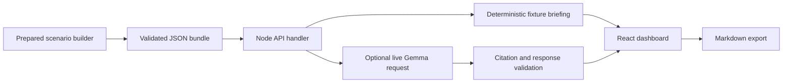

# RepoGraph Review Desk architecture

The companion consists of a prepared evidence bundle, a Node HTTP API, and a React 19/TypeScript/Vite dashboard served on one origin.

`bootstrap/server.mjs` owns listening and static assets. Without `API_HANDLER_MODULE`, it selects the mock API. With `API_HANDLER_MODULE=service/api-handler.mjs`, it loads the modular service; an explicit handler startup failure is fatal. Cloudways process managers that import an entry module use `deployment/cloudways-entry.mjs`.

`service/api-handler.mjs` exports `createApiHandler({projectRoot, bundlePath})`, validates the artifact at startup, and handles every API response. `service/briefing.mjs` assembles trusted provenance and limitations, validates model evidence IDs, and renders Markdown. `service/gemma-client.mjs` owns provider requests. Fixture mode makes no model calls; live mode reports provider errors without canned fallback.

`analysis/build_dataset.py` currently emits a fixed prepared scenario. It does not run an AST indexer or Graphify; its producer labels are supplied metadata, not proof of an executed pipeline. The copied upstream analyzer lives under `vendor/repograph/` and is independently licensed. See the analysis guide for verification limits.

`web/` renders evidence, original confidence labels, inference/provenance labels, and limitations. Playwright checks desktop/mobile behavior, Markdown export, errors, and automated accessibility. Automated scans do not establish complete accessibility compliance.
