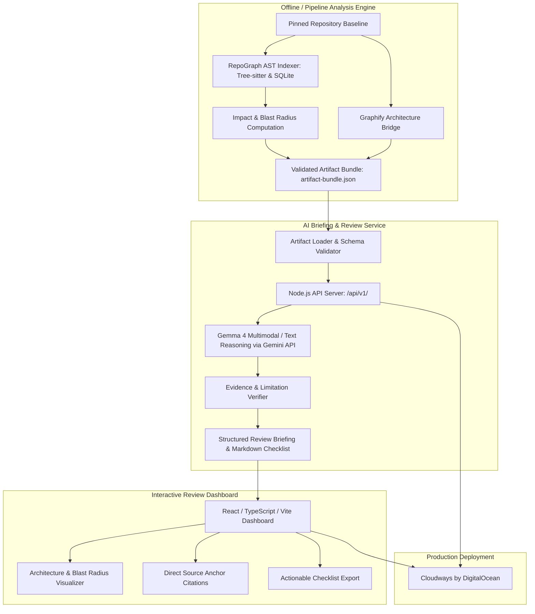

# RepoGraph Review Desk — System Architecture

RepoGraph Review Desk is an automated, evidence-backed code review companion and visualization suite. It maps repository impact deterministically and synthesizes code review briefings using Google Gemma 4 (via Google Gemini API), presenting an interactive, accessible dashboard deployable to Cloudways by DigitalOcean.

---

## Architecture Overview

---

## Functional Layers

### 1. Analysis Engine (`analysis/`)
- **AST Parsing**: Multi-language Tree-sitter grammars (Python, JS/TS, Go, Rust) create SQLite indexes of symbol declarations, calls, imports, and definitions.
- **Impact Computation**: Computes exact blast radii for changed files via reverse dependency graph traversal.
- **Graphify Bridge**: Generates standardized architectural relationships (`graphify` nodes and links) to provide high-level contextual awareness.
- **Artifact Bundle**: Emits immutable, schema-validated bundles (`contracts/artifact-bundle.schema.json`) detailing cases, static citations, and blind spots.

### 2. Briefing Service (`service/`)
- **Schema Contracts**: Strictly enforces input/output schema conformity (`contracts/briefing.schema.json`).
- **Gemma 4 Reasoning**: Connects with `gemma-4-26b-a4b-it` or `gemma-4-31b-it` to analyze change intent against verified static dependencies.
- **Citation Guardrails**: Enforces that all assertions cite verified evidence IDs and all caveats/limitations are preserved verbatim.
- **Markdown Generator**: Compiles downloadable, Markdown review checklists with repository line-anchor links.

### 3. Review Desk Dashboard (`web/`)
- **Frontend Stack**: React 18, TypeScript, and Vite with zero external UI bloat.
- **Scenario Explorer**: Enables reviewers to browse affected modules and dependency blast radii.
- **Source Linkage**: Links every piece of evidence directly to immutable GitHub commit anchors.
- **Accessibility & Responsiveness**: 100% automated accessibility compliance tested via Axe and Playwright across mobile and desktop viewports.

### 4. Infrastructure & Deployment (`deployment/`)
- **Cloudways Deployment**: Full automation and runbooks for automated git-based deployment to Cloudways by DigitalOcean.
- **Preflight & Verification**: Integrated test suites for offline verification, schema validation, and health checks.
