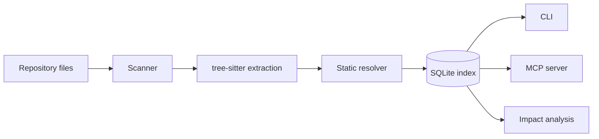

# Architecture

RepoGraph is a batch indexer plus read-only query layer. There is no daemon and no network service by default. One SQLite database lives in `.repograph/index.db`.



## Modules

| Module | Responsibility |
| --- | --- |
| `config.py` | Default exclusions, JSON config, index location, `safe_path` boundary checks |
| `scanner.py` | File discovery, language detection, exclusion, symlink and size limits |
| `extract.py` | tree-sitter parsing for Python, TypeScript, TSX, JavaScript, JSX and Prisma |
| `resolve.py` | Module/path resolution to repository files |
| `indexer.py` | Two-pass incremental pipeline, binding resolution, statistics |
| `store.py` | SQLite schema, transactions, evidence queries |
| `query.py` | Search, graph traversal, cycles, architecture, status, doc mentions |
| `impact.py` | Change-impact analysis, git diff parsing, blind spots |
| `cli.py` | Typer commands |
| `mcp_server.py` | Six read-only MCP tools |

## Data model

```
files 1──n symbols
files 1──n imports ──0..1 files (target)
files 1──n refs ─────0..1 files (target)
files 1──n routes
```

Paths are repository-relative POSIX paths. Foreign keys cascade from `files`.

Key fields:

- `files.sha256`, `size`, `mtime`, `parsed`, `parse_error` — incremental and health state.
- `symbols.qualified_name`, `kind`, `start_line`/`end_line`, `tags` — definitions and heuristic tags such as `db_model`.
- `imports.method`, `confidence`, `kind`, `names`, `note` — how an edge was produced and how sure it is.
- `refs.target_name` — the imported/defined name a reference resolved to, not merely the source token.
- `routes.framework`, `confidence` — route extraction provenance.

Every user-controlled value is bound, never interpolated. Dynamic SQL only interpolates generated `?` placeholder lists.

## Indexing

`index_repository` is incremental and two-pass:

1. **Scan** with default exclusions, secret globs, symlink policy, file-size cap and `max_files`.
2. **Classify** against existing rows. A file is skipped when size and mtime match, or when the SHA-256 is unchanged. `--force` reparses everything; `--reset` drops tables.
3. **Register pending files** before parsing so an import can target a file indexed later in the same run.
4. **Extract** symbols, imports, references and routes. Extraction works on bytes and never imports the target module.
5. **Resolve** imports into repository-relative target paths and confidence/method metadata.
6. **Bind references** in priority order: same-file symbol, imported name, module-object/instance attribute, then `unresolved`.
7. **Commit** per file, checkpoint WAL, report stats.

Parse failures are retained with `parsed=0` and a bounded error string. One bad file does not abort the run.

## Import resolution

Python:

- Relative imports (`from . import x`, `from ..models import Y`) are normalized against the current package.
- Absolute imports are tried against the repo root, the nearest `src` directory and common source roots.
- `import a.b as c` and `from a import b as c` produce local bindings.
- Syntactic `importlib.import_module("literal")` and `__import__("literal")` are recorded as `dynamic` when the argument is a string literal.
- External packages are recorded as `external`, not silently discarded.

TypeScript / JavaScript:

- Relative imports resolve with extension probing (`.ts`, `.tsx`, `.js`, `.jsx`, `.mjs`, `.cjs`, `/index.*`).
- `tsconfig.json` / `jsconfig.json` `baseUrl` and `paths` aliases are honored, including nested configs.
- Workspace `package.json` names map imports such as `@scope/pkg` to their package directory.
- CommonJS `require("...")` and dynamic `import("...")` are extracted.
- Bare package imports are `external`; computed targets are `dynamic` or `unresolved`.

Resolution never reads outside the repository. Failures remain visible as `unresolved` or `external`.

## Graph algorithms

- **Dependency graph** — breadth-first traversal over `imports` edges, direction `in`, `out` or `both`, bounded depth (1–5).
- **Cycles** — iterative Kosaraju strongly connected components over file edges. No NetworkX dependency.
- **Impact** — direct dependents from reverse imports plus resolved reference sites; transitive dependents from reverse-import BFS; tests from import edges and path-name conventions; routes/models from affected files.
- **Architecture** — layer classification by path, inbound/outbound directory counts, hubs, entry-point heuristics.

Impact output is deliberately a report, not a verdict:

```json
{
  "direct_dependents": [],
  "blind_spots": [{"kind": "no-static-dependents"}],
  "caveats": ["Absence of a relationship is not evidence that a change is safe."]
}
```

## Search

`search_symbols` is a lexical `LIKE` match over `name` and `qualified_name`, with optional kind filtering. `search` also scans indexed source bytes and documentation files (`.md`, `.mdx`, `.rst`, `.txt`, `.adoc`) for literal text. It is not semantic search.

## MCP layer

`build_server` creates a `MCPServer` from the official Python SDK and registers six tools. Each tool opens a short-lived SQLite connection, calls the same query functions as the CLI, and returns a plain dictionary. Tool exceptions become `{"error": "..."}` rather than crashing the server.

`REPOGRAPH_ROOT` selects the repository for `python -m repograph.mcp_server`; `repograph serve --root` is the CLI path. The server fails fast if no index exists.

## Deliberate omissions

- No daemon, watch mode, LSP, embeddings or remote service.
- No type inference, macro expansion, build-system graph or data-flow analysis.
- No cross-repository index.
- No write operations against the analyzed repository.

These omissions keep the tool auditable. They are also why results are labeled partial.
