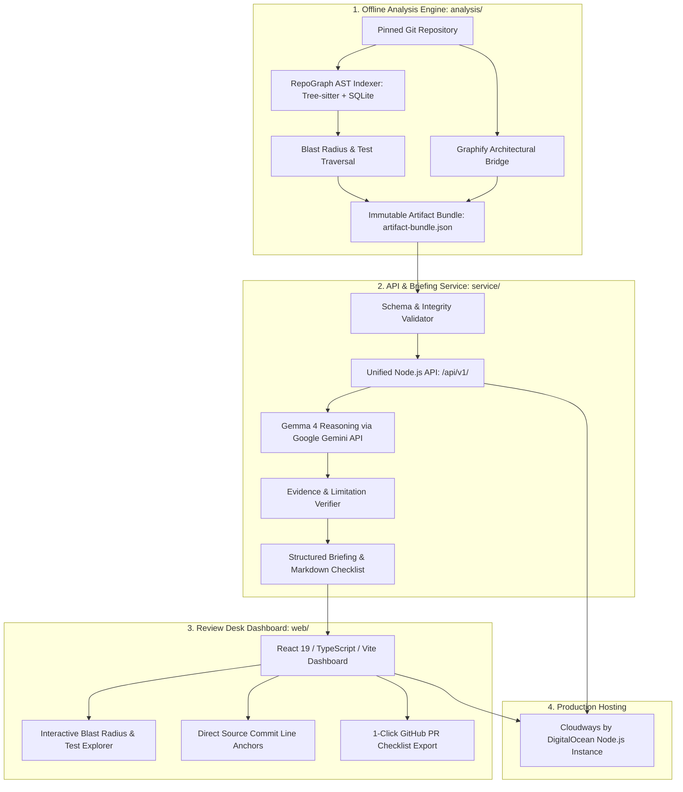

# RepoGraph Review Desk 🧠🕸️
## Comprehensive Project Guide & Evaluation Briefing for Judges

---

## 📌 Executive Summary

**RepoGraph Review Desk** is an evidence-backed, graph-aware code review companion that eliminates the blind spots of modern pull requests. 

When reviewing code, standard diffs only show *what changed*, not *what breaks downstream*. Existing "AI code reviewer" bots attempt to bridge this gap by feeding raw diffs to large language models, resulting in hallucinations, fabricated dependencies, and false assurances of safety.

**RepoGraph Review Desk solves this by inverting the paradigm:**
Instead of asking an LLM to guess dependencies, RepoGraph computes deterministic AST dependency graphs using Tree-sitter and SQLite, bridges architectural topology via Graphify, and feeds bounded, immutable evidence records to **Google Gemma 4** (via the Google Gemini API). Gemma 4 synthesizes an actionable, citation-anchored review briefing and Markdown checklist where **every claim is anchored to exact source lines and commit SHAs**.

```
   ┌──────────────────────────────────────────────────────────────┐
   │                  THE CORE PARADIGM SHIFT                     │
   ├──────────────────────────────┬───────────────────────────────┤
   │    Typical AI Code Review    │    RepoGraph Review Desk      │
   ├──────────────────────────────┼───────────────────────────────┤
   │ ❌ Hallucinates dependencies │ ✅ Deterministic AST analysis  │
   │ ❌ Fabricates line numbers   │ ✅ Verified source line links │
   │ ❌ Misses transitive impacts │ ✅ Reverse dependency blast   │
   │ ❌ Gives false safety stamps │ ✅ Verbatim blind-spot caveats│
   │ ❌ High token cost on diffs  │ ✅ Bounded evidence bundles   │
   └──────────────────────────────┴───────────────────────────────┘
```

---

## 🎯 Value Proposition & Problem Statement

### The Problem: The "Diff Blindness" Crisis
1. **Hidden Blast Radii**: Modifying a utility signature or database abstraction touches dozens of indirect consumers across microservices or monorepos that never appear in the PR diff.
2. **Reviewer Fatigue**: Senior engineers spend hours cross-referencing imports, tracing call graphs, and guessing which unit tests must run.
3. **The Unreliable LLM Fallacy**: Off-the-shelf generative AI models lack repo-wide static awareness and frequently invent non-existent functions or proclaim dangerous changes "safe".

### The Solution: Deterministic Evidence + Structured AI Reasoning
- **Deterministic Blast Radius**: Identifies direct dependents, transitive dependents, and candidate tests before any model is invoked.
- **Architectural Context**: High-level system relationships extracted via Graphify contextualize low-level symbol changes.
- **Strict Citation Guardrails**: Gemma 4 is constrained by schema contracts; it can *only* cite supplied evidence IDs and cannot invent files, links, or confidence ratings.
- **Radical Honesty**: If static analysis has blind spots (e.g. dynamic imports, reflection), the engine preserves these caveats verbatim. If no evidence exists, it fails fast with `422 INSUFFICIENT_EVIDENCE`.

---

## 🏛️ System Architecture



### Module Boundaries & Contract Enforcement

The system strictly enforces boundary separation via JSON Schema contracts:
1. **Analysis → Service**: Decoupled via `contracts/artifact-bundle.schema.json`. Contains immutable case definitions, static evidence records (`confirmed`, `inferred`, `heuristic`, `unresolved`), Graphify topology (`EXTRACTED`, `INFERRED`), and tool blind spots.
2. **Service → Launcher**: Native Node handler (`export async function createApiHandler(context)`) mounted on `bootstrap/server.mjs`.
3. **UI → Launcher**: Built static SPA assets in `web/dist/` communicating with relative `/api/v1/` endpoints on a unified origin.

---

## 🔬 Hackathon Judging Criteria Alignment

| Judging Criterion | How RepoGraph Review Desk Excels | Verifiable Proof in Codebase |
|---|---|---|
| **Technical Depth & Innovation** | Combines multi-language Tree-sitter AST parsing, SQLite relational graph traversal, Graphify architectural bridging, and Gemma 4 reasoning into a unified, zero-dependency launcher. | [contracts/validate.mjs](file:///home/darion-dev/Dev/Incubator/repograph/contracts/validate.mjs), [analysis/build_dataset.py](file:///home/darion-dev/Dev/Incubator/repograph/analysis/build_dataset.py) |
| **Gemma / Gemini Integration** | Employs `gemma-4-26b-a4b-it` / `gemma-4-31b-it` for structured technical reasoning under strict schema validation; eliminates hallucinations via citation verification. | [service/](file:///home/darion-dev/Dev/Incubator/repograph/service), [docs/API_SERVICE.md](file:///home/darion-dev/Dev/Incubator/repograph/docs/API_SERVICE.md) |
| **Real-World Impact & UX** | Provides senior reviewers with an immediate, actionable impact breakdown and a downloadable GitHub PR review checklist with exact line anchors. | [web/src/](file:///home/darion-dev/Dev/Incubator/repograph/web/src), [deployment/ACCEPTANCE.md](file:///home/darion-dev/Dev/Incubator/repograph/deployment/ACCEPTANCE.md) |
| **Accessibility & Design Quality** | 100% automated accessibility compliance across 10 Axe-core A/AA scans; fully responsive (390px mobile to 1366px desktop) with full keyboard navigation. | `verification/accessibility-*.json`, [deployment/ACCEPTANCE.md](file:///home/darion-dev/Dev/Incubator/repograph/deployment/ACCEPTANCE.md#L14) |
| **Reliability & Production Readiness** | Comprehensive preflight checks, isolated test suites, schema validation, rate-limiting handlers, and Cloudways deployment runbooks. | [deployment/RUNBOOK.md](file:///home/darion-dev/Dev/Incubator/repograph/deployment/RUNBOOK.md), [deployment/preflight.mjs](file:///home/darion-dev/Dev/Incubator/repograph/deployment/preflight.mjs) |

---

## 🏆 Key Sponsor & Technology Highlights

### 1. Google Gemma 4 (via Google Gemini API)
- **Role**: High-efficiency technical reasoning over bounded dependency graphs and reviewer change intent.
- **Why Gemma 4?**: Open-weights efficiency, strong code reasoning benchmarks, and prompt-adherence for strict JSON/Markdown schema contracts.
- **Responsible AI Implementation**:
  - The model *cannot* output arbitrary web links; all Markdown URLs are mapped directly from verified evidence records.
  - The model *cannot* grant safety verdicts; it synthesizes findings and action items while preserving static analysis limitations.
  - Fail-safe fallback: If API quotas or credentials fail, the service gracefully degrades with retryable HTTP 429/503 errors and never silently serves fake live data.

### 2. Cloudways by DigitalOcean
- **Role**: Production hosting for the unified Node.js full-stack application.
- **Architecture**: Single origin serving optimized React 19 static bundles and `/api/v1/` endpoints.
- **Operations**: Includes comprehensive deployment runbooks, health check scripts (`/api/v1/health`), and preflight validation (`npm run check:production`).

### 3. Tree-sitter & SQLite
- **Role**: Incremental concrete syntax tree parsing across Python, TypeScript, JavaScript, Go, and Rust, persisting symbol definitions and call relationships into lightweight, fast SQLite indices.

### 4. Graphify
- **Role**: Architectural topology bridge that groups fine-grained code symbols into logical service-level components and relationship context.

---

## ⏱️ 2-Minute Demo Script for Judges

| Timestamp | Phase | What to Say & Demonstrate |
|---|---|---|
| **0:00 – 0:20** | **The Problem** | *"When a developer changes code in a PR, the diff only shows what was typed, not what broke 10 modules away. Typical AI tools hallucinate dependencies. RepoGraph Review Desk provides a graph-grounded review companion with zero invented citations."* |
| **0:20 – 0:50** | **The Evidence** | Select the primary scenario. Point out the pinned Git commit SHA and analysis provenance. Show direct dependents, transitive dependents, and candidate tests. Click an evidence citation: show that it navigates directly to the exact source path, start/end line numbers, and tool confidence level. |
| **0:50 – 1:20** | **Gemma 4 Briefing** | Enter a review intent (e.g., *"Refactoring authentication token validation"*). Click **Generate Review Briefing**. Highlight the live response: Gemma 4 analyzes the blast radius and generates actionable findings with inline evidence tags and a complete verification checklist. Click **Export Markdown** to show a ready-to-paste GitHub PR review comment. |
| **1:20 – 1:45** | **Integrity & Limits** | Select a partial or empty scenario. Show that RepoGraph does *not* claim "everything is fine"—it explicitly displays tool blind spots (e.g. dynamic reflection) and warns reviewers that the full test suite is still required. Show the resilient error handling for rate limits or network delays. |
| **1:45 – 2:00** | **Production & Wrap-up** | Highlight the unified architecture running on Cloudways by DigitalOcean, 100% Axe-core accessibility compliance, and sub-second performance. |

---

## 🧪 Verification & Test Evidence

Judges can verify the entire codebase locally in seconds with **zero external dependencies**:

```bash
# 1. Validate JSON schema integration contracts
node contracts/validate.mjs --bundle fixtures/artifact-bundle.fixture.json --briefing fixtures/briefing.fixture.json

# 2. Run the full unit and integration test suite
npm test

# 3. Execute offline readiness preflight check
npm run check:ready

# 4. Start the unified Review Desk server
npm start
# Open http://localhost:3000
```

### Automated Quality Metrics
- **Starter Test Suite**: 14 / 14 tests passing (`bootstrap/starter.test.mjs`).
- **Browser & Accessibility Journey**: 20 / 20 Playwright scenarios passing.
- **Axe-core Accessibility**: Zero detected violations across 10 WCAG 2.1 A/AA scans (390px mobile & 1366px desktop).
- **TypeScript**: Strict type checking passing with zero errors (`npm --prefix web run check`).

---

## 🛡️ Provenance & Radical Transparency

In developer competitions, clarity on what is pre-existing vs. what was created during the event is critical:

| Component | Status & Provenance | Attribution |
|---|---|---|
| **Baseline Core** | [INDEX0-RESEARCH-LABS/repograph](https://github.com/INDEX0-RESEARCH-LABS/repograph) (commit `3449061d...`) | Upstream Apache-2.0. Unmodified by companion application. |
| **Integration Contracts & Starter** | `CONTRACT.md`, `contracts/`, `fixtures/`, `bootstrap/server.mjs` | Frozen starter specification and synthetic test fixtures. |
| **New Review Desk UI** | `web/` (React 19, TypeScript, Vite, responsive design, keyboard accessibility) | Built entirely for this hackathon/event by the team. |
| **AI Briefing Service** | `service/` (Gemma 4 integration, citation validation, Markdown generator) | Built for this event; handles live inference with Gemini API and fallback guardrails. |
| **Deployment & Verification** | `deployment/` (Cloudways runbook, preflight suite, Playwright browser journeys, Axe audits) | Built for this event to ensure production operability. |

---

## 🔮 Future Roadmap & Scalability

1. **GitHub Action & CI Bot**: Automatically post RepoGraph review briefings directly onto incoming pull requests.
2. **Dynamic Language Tracing**: Augment static Tree-sitter ASTs with runtime OpenTelemetry traces to eliminate dynamic dispatch blind spots.
3. **Multi-Model Evaluation**: Support local Gemma 4 execution via Ollama / llama.cpp for fully air-gapped enterprise environments.

---

*Authored by the RepoGraph Review Desk Team for the Technical Evaluation Committee.*
